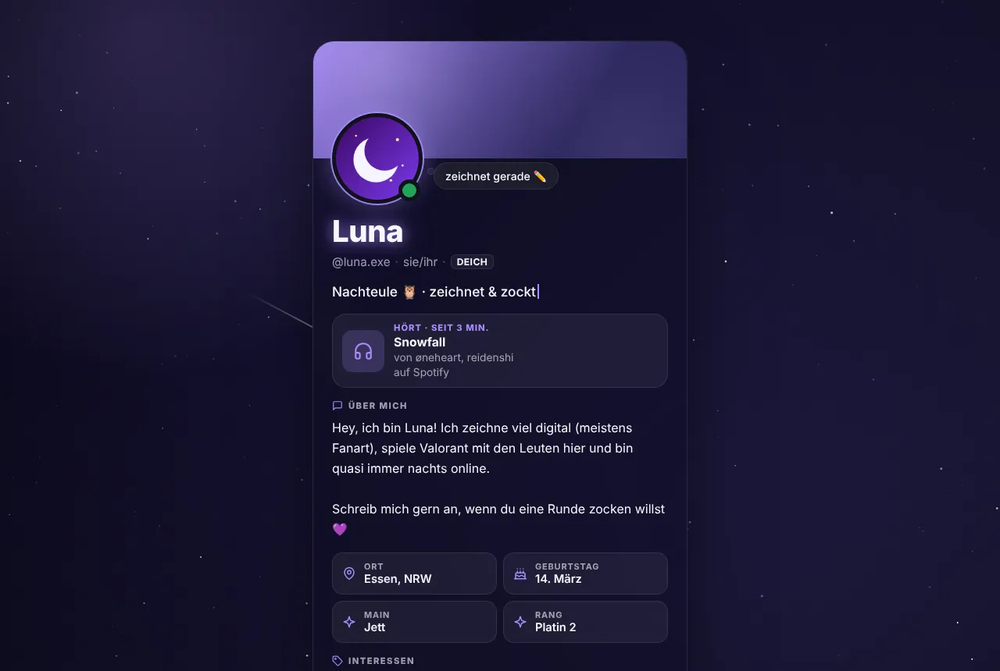
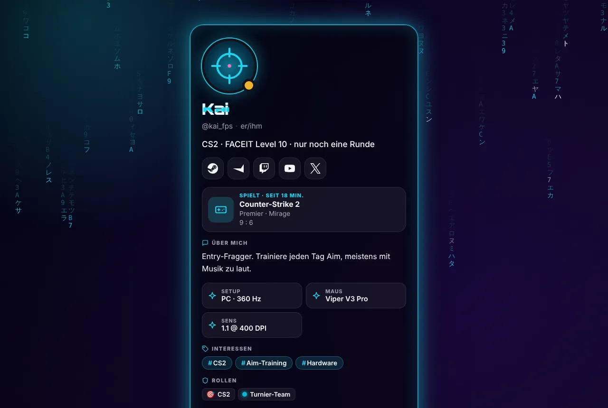
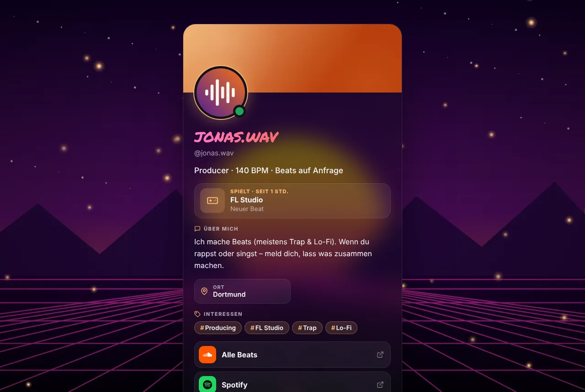
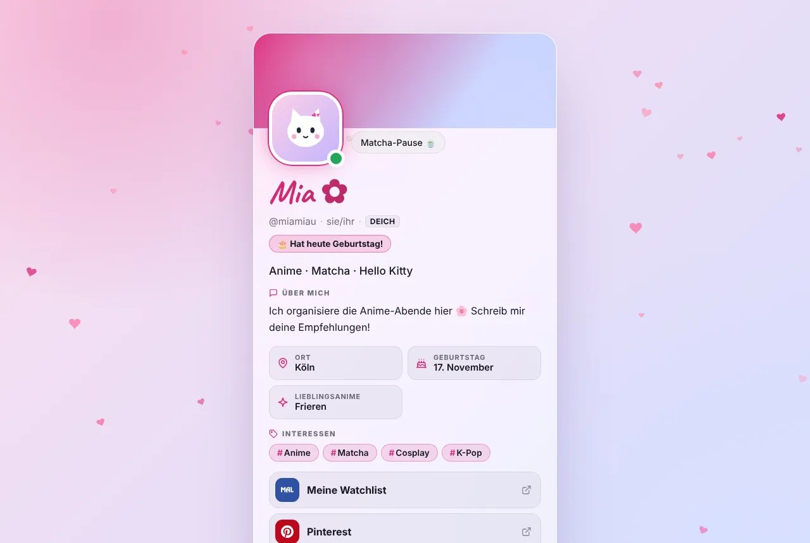
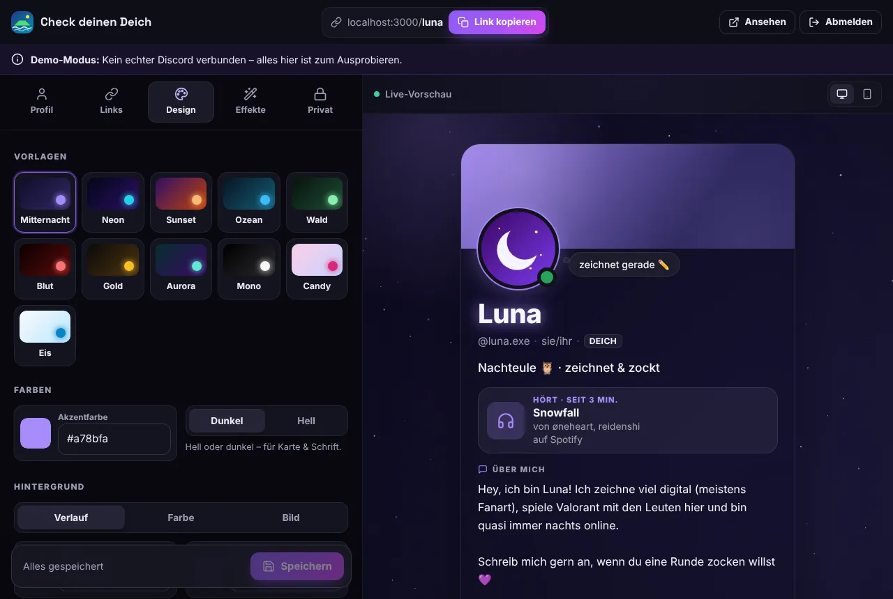

# Check deinen Deich – Profile 🌊✨

Ein **Discord-Bot + Website**, mit der sich jedes Server-Mitglied eine eigene Profilseite baut – mit Bio, Links, Lieblingssong, Hintergrundbild, Effekten und allem Drum und Dran. Den Link packt man in sein Discord-„Über mich“, und wer draufklickt, sieht alles über die Person: inklusive Server-Rollen, Online-Status und was sie gerade spielt oder hört.

<p align="center">
  
  
  
  
</p>

## So funktioniert's

1. Im Discord `/profil bearbeiten` eingeben (oder im Profil-Panel auf **Profil bearbeiten** klicken).
2. Der Bot schickt einen **privaten Login-Link** (nur für dich sichtbar, 15 Minuten gültig, nur einmal benutzbar).
3. Im Browser das Profil gestalten – mit **Live-Vorschau**.
4. **Link kopieren** und ins Discord-„Über mich“ einfügen. Fertig! 🎉



## Was alles geht

**Profil:** Anzeigename, Status-Zeile, „Über mich“, Pronomen, Ort, Geburtstag (ohne Jahr, mit 🎂 am Tag selbst), Interessen, eigene Infos (z. B. *Main-Game: Valorant*), bis zu 12 Links mit automatisch erkannten Icons (Instagram, TikTok, YouTube, Twitch, Steam, Spotify, FACEIT … über 50 Plattformen), Lieblingssong (Spotify / YouTube / SoundCloud).

**Design:** 11 Farb-Vorlagen, eigene Akzentfarbe, Hell/Dunkel, Hintergrund als animierter Verlauf, Farbe oder eigenes Bild (auch **animierte GIFs**), Unschärfe & Abdunkeln, Banner (Discord-Banner, eigenes Bild oder Farbe), 4 Karten-Stile (Glas, Solide, Neon, ohne Karte), 8 Schriften für den Namen.

**Effekte:** Sterne, Schnee, Regen, Glühwürmchen, Netzwerk, Matrix, Herzen, Kirschblüten · Namens-Effekte (Leuchten, Verlauf, Regenbogen, Glitch, Glanz) · Schreibmaschinen-Animation · 3D-Neigung der Karte.

**Von Discord automatisch:** Avatar (inkl. Server-Avatar & Avatar-Deko), Banner, Server-Rollen mit Farben & Icons, Server-Tag, „Auf dem Server seit“, Booster-Status – und optional **Live-Status** (Online/Abwesend/DND, Custom-Status, „Spielt Valorant“, „Hört … auf Spotify“). Jeder kann einzeln ausschalten, was angezeigt wird.

**Website:** Mitgliederliste mit Suche, schöne Link-Vorschau, wenn ein Profil-Link in Discord gepostet wird, eigene Profil-Adresse (`deine-seite.de/name`), Aufrufe-Zähler, funktioniert auf dem Handy.

**Bot-Befehle:**

| Befehl | Was passiert |
|---|---|
| `/profil bearbeiten` | Privater Login-Link zum Editor (legt beim ersten Mal das Profil an) |
| `/profil link` | Zeigt deinen Link + Anleitung, wie er in die Bio kommt |
| `/profil anzeigen [mitglied]` | Postet eine Profil-Karte in den Chat |
| Rechtsklick auf Person → **Apps → Profil anzeigen** | Zeigt das Profil privat an |
| `/profil-admin panel [kanal]` | Postet eine Nachricht mit Buttons „Profil bearbeiten“ / „Mein Link“ / „Alle Profile“ |
| `/profil-admin ausblenden` / `einblenden` / `entfernen` | Moderation (nur mit „Server verwalten“) |

> **Wichtig:** Den Link in die Bio setzen kann der Bot nicht selbst – das erlaubt Discord keinem Bot. Jeder kopiert ihn einmal selbst rein (`/profil link` erklärt wie).

---

## Erstmal nur angucken (ohne Discord)

Du brauchst [Node.js](https://nodejs.org) ab Version 20.12.

```bash
npm install
npm run demo
```

Dann <http://localhost:3000> öffnen – da sind ein paar Beispiel-Profile. Unter <http://localhost:3000/demo> kannst du dich als Beispiel-Person in den Editor einloggen.

## Richtig einrichten

### 1. Bot im Discord Developer Portal anlegen

1. <https://discord.com/developers/applications> → **New Application** → Namen geben (z. B. „Deich-Profile“).
2. Links auf **Bot** → **Reset Token** → Token kopieren. *Den Token niemandem zeigen!*
3. Optional für Online-Status & „Spielt gerade …“: auf derselben Seite unter *Privileged Gateway Intents* den **Presence Intent** einschalten.

### 2. Bot auf den Server einladen

Links auf **OAuth2** → *OAuth2 URL Generator*: Scopes **`bot`** und **`applications.commands`** ankreuzen, bei den Bot-Rechten **View Channels**, **Send Messages** und **Embed Links**. Den Link unten öffnen und deinen Server auswählen.

(Alternativ: Bot einfach starten – wenn er noch nicht auf dem Server ist, schreibt er dir den fertigen Einladungslink in die Konsole.)

### 3. Konfigurieren

```bash
cp .env.example .env
```

Und in der `.env` mindestens das hier eintragen:

```ini
DISCORD_TOKEN=dein-bot-token
GUILD_ID=123456789012345678        # Rechtsklick auf den Server → „Server-ID kopieren“ (Entwicklermodus nötig)
PUBLIC_URL=https://profile.deine-domain.de
DISCORD_PRESENCE_INTENT=true       # nur wenn du den Presence Intent eingeschaltet hast
```

`PUBLIC_URL` ist die Adresse, unter der die Website **öffentlich** erreichbar ist – genau diese Links landen nachher in den Bios. Alle weiteren Einstellungen sind in [`.env.example`](.env.example) erklärt.

### 4. Starten

```bash
npm install
npm start
```

Der Bot meldet sich an, registriert die Befehle auf deinem Server und die Website läuft auf Port 3000.

### 5. Im Discord loslegen

Schreib in einem Kanal (z. B. `#profile`) `/profil-admin panel` – dann bekommen alle eine Nachricht mit Buttons und müssen sich keine Befehle merken.

## Online stellen

Damit die Links in den Bios für alle funktionieren, muss die Website im Internet erreichbar sein (am besten mit HTTPS). Zwei einfache Wege:

**A) Server/VPS mit Docker**

```bash
cp .env.example .env    # ausfüllen, TRUST_PROXY=1 setzen
docker compose up -d --build
```

Davor einen Reverse-Proxy für HTTPS, z. B. [Caddy](https://caddyserver.com) – die komplette `Caddyfile`:

```
profile.deine-domain.de {
    reverse_proxy localhost:3000
}
```

**B) Eigener PC oder Raspberry Pi mit Cloudflare Tunnel** – ohne Portfreigabe: [Cloudflare Tunnel](https://developers.cloudflare.com/cloudflare-one/connections/connect-networks/) auf `http://localhost:3000` zeigen lassen, `PUBLIC_URL` auf die Tunnel-Domain setzen und `TRUST_PROXY=1`.

> Hinter einem Proxy immer `TRUST_PROXY=1` setzen, sonst funktionieren Aufrufe-Zähler und Spam-Schutz nicht richtig.

## Datenschutz & Sicherheit

- **Nur wer mitmacht, hat ein Profil.** Der Bot speichert nur Daten von Leuten, die `/profil bearbeiten` benutzen. Jeder kann sein Profil privat stellen, aus der Liste nehmen oder komplett löschen.
- **Login ohne Passwort:** Einmal-Links vom Bot, 15 Minuten gültig. Links und Sitzungen werden nur gehasht gespeichert.
- **Hochgeladene Bilder** werden neu kodiert – dabei fliegen alle Metadaten raus (z. B. GPS-Standort aus Handyfotos).
- **Keine Tracker, keine Google-Fonts:** Schriften sind selbst gehostet. Spotify/YouTube werden erst nach Klick auf „Abspielen“ geladen. Aufrufe werden ohne gespeicherte IP-Adressen gezählt.
- **Keine fremden Bild-Links:** Bilder kommen nur als Upload oder von Discord – so kann niemand über ein eingebundenes Bild die IPs der Besucher abgreifen.
- Strikte Content-Security-Policy, Schutz gegen XSS und CSRF, Rate-Limits.
- Suchmaschinen werden standardmäßig ausgesperrt (`ALLOW_INDEXING=false`).
- Läuft die Seite öffentlich, braucht sie je nach Fall ein Impressum und eine Datenschutzerklärung – das musst du selbst klären.

## Daten & Backups

Alles liegt im Ordner `data/` (bzw. im Docker-Volume `profile-data`): `db.json` mit allen Profilen und `uploads/` mit den Bildern. Einfach den Ordner sichern.

## Entwicklung

```bash
npm run dev      # startet neu bei Code-Änderungen
npm run demo     # ohne Discord, mit Beispiel-Profilen
npm test         # alle Tests
npm run assets   # Icons & Schriften neu erzeugen (braucht devDependencies)
```

```
src/
  index.js            Startpunkt
  config.js           Einstellungen aus .env
  store.js            JSON-Speicher (atomare Writes)
  demo.js             Demo-Modus
  bot/                Discord-Bot (Befehle, Discord-Daten)
  web/                Website (Express, Seiten, Uploads, Sicherheit)
  shared/             Profil-Modell & Renderer – läuft auf dem Server UND im Browser (Live-Vorschau)
public/               CSS, Browser-JS (Effekte, Editor), Schriften
test/                 Tests (node --test)
```

## Lizenzen von Drittinhalten

Marken-Icons: [Simple Icons](https://simpleicons.org) (CC0, die Marken gehören ihren Inhabern) · Schriften: Space Grotesk, Orbitron, Press Start 2P, Playfair Display, JetBrains Mono, Caveat, Permanent Marker (SIL Open Font License, via Fontsource) · UI-Icons im Stil von [Lucide](https://lucide.dev) (ISC).
